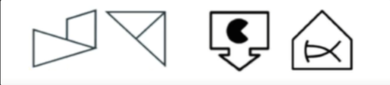
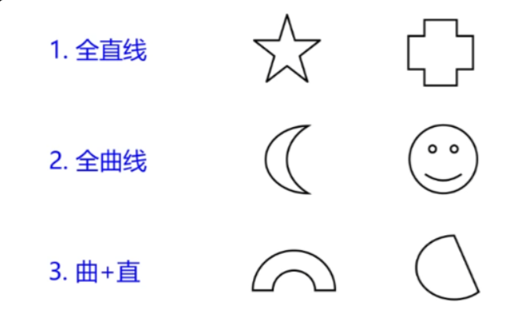
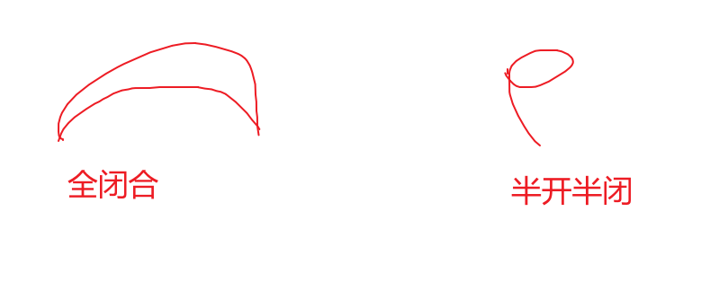

# 1. 性质

**特点**：元素组成不同，不相似

（意思当位置，样式规律不弄用，考虑属性规律）

# 2. 对称性

## 考法

### 对称类型

1. 中心对称
2. 轴对称
3. 轴对称 + 中心对称

---

### 对称轴方向/数量

1. 数量：如果是数量对称轴可以是多个
2. 方向：一般对称轴只有一条

---

### 对称轴和线、点、面关系

考察优先级： 线>点>面

1. 线：考察是否和图像一条线重合
2. 点：考察是否经过点（不考察经过几个点）
3. 面：考察经过**几个**面

---

### 图像有两个面，分开看

1. 对称轴方向关系：平行/垂直/成角度
2. 对称轴数量关系：外部比内部多n条
3. 对称类型组合：轴对称+中心对称组合

---

# 3. 曲直

（一般对称没辙了，考虑）

**考法**：因为这种太简单了，喜欢结合其他考

1. 曲直 + 面数量
2. 曲直性:全曲、全直、有曲有直
3. 内外分别曲直
4. 曲直+笔画
5. 有些事业编：**全曲和全直**一类，**有曲有直**一类

---

# 4. 开闭性

**问：什么是闭合图？**

答：一条直线/曲线，**头**到**尾**形成闭合就是封闭，如果是一条直线一端没形成闭合就不是全闭合

## 分类：

1. 全闭合
2. 全开：比如一条曲线
3. 半开半闭合：有一个闭合图，但是有曲线一端没闭合

## 考法

1. 开闭
2. 结合其他考

