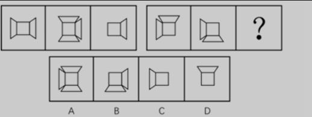

# 图形特征
元素特征：相似

> 相似：这里是有相同的轮廓，但又不完全相同，如图
>
> 

# 加减异同
## 基本考法
针对线条

<!-- 这是一张图片，ocr 内容为： -->

## 样式 + 位置结合
1. 一般考都会位置和样式相结合
2. 先后顺序：
    1. 先位置再样式
    2. 先样式再位置

<!-- 这是一张图片，ocr 内容为： -->

求异

求异加旋转

# 黑白运算
## 特征
与加减异同不一样，加减异同主要是线条，这个是大片面积

<!-- 这是一张图片，ocr 内容为： -->

+ 黑 + 黑 = ？
+ 黑 + 白 = ？
+ 白 + 黑 = ？
+ 白 + 白 = ？

## 黑白运算 与 平移的区别
<!-- 这是一张图片，ocr 内容为： -->

## 黑白运算的特殊形式
<!-- 这是一张图片，ocr 内容为： -->

## 做题方法
+ 老老实实一个个看
+ 大块一起看

## 黑白运算隐藏轮廓
个人觉得有点难看

<!-- 这是一张图片，ocr 内容为：[例2](2023国考)从所给的四个选项中,选择最合适的一个填入问号处,使之 呈现一定的规律性. 开交 5 第一行:求异 求异(同色留白,异色留黑) 第二行: 第三行:求异(相同留白,不同留球) -->

选C

实战

A

