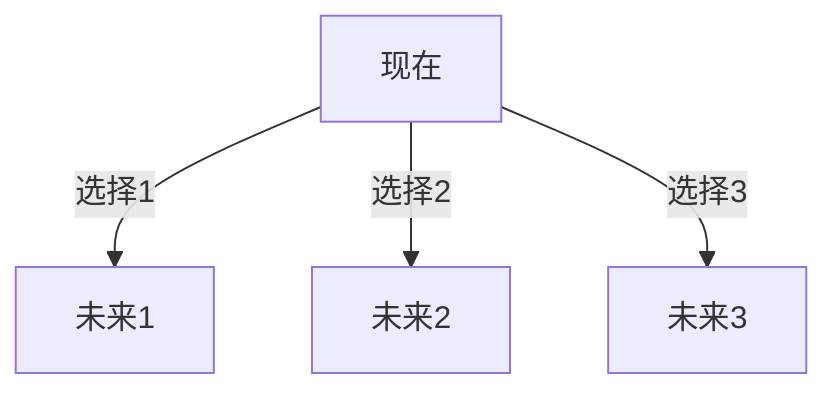

假若能穿越到过去，是不是意味着人的未来也是确定的，你现在能回到过去，证明有个地方本身就存在未来和过去，现在对于过去就是未来，那么事情已经经历过了，已经是确定的了

那么现在的未来，犹如过的相对现在，事已经是确定了，现在即是过去，又是现在，又是未来

太诡异了，瞬间感觉努力没用了

但是换个角度想，我现在即使过去，那么通过努力，把事情做好，未来没做好的自己不是不会后悔吗？所有个人奋斗是有用的，ok，假设未来就是确定的，但是我们不知道，你通过奋斗变得很好，假设一条时间线自己过的很差，你懊悔，心中暗想，要是过去我不那样做，现在不就是过去吗？
换句话说，加入世界不是单向，而是树桩节点，做某件事情就回某种走向，虽然未来是确定的，但是选择不同，未来导向也不同，这样想未来好像是确定的，但是你不同的做法，只是走向不同的未来，好像解释也很合理
